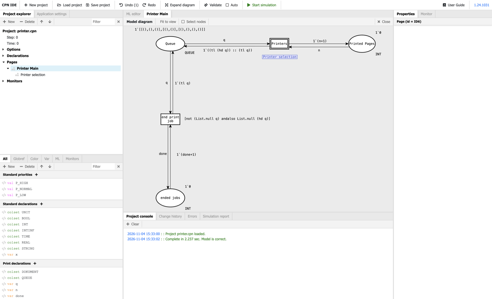
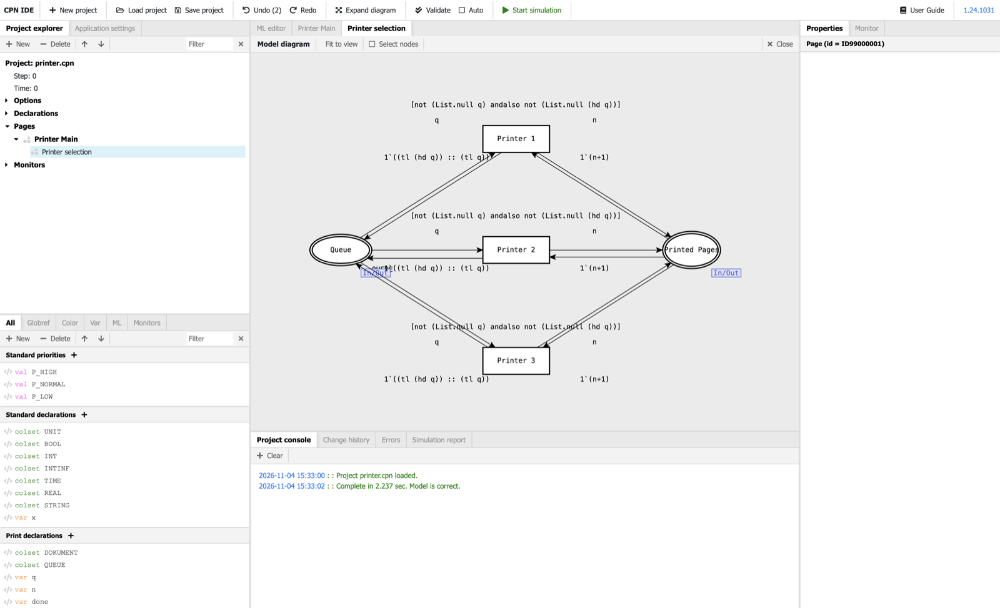
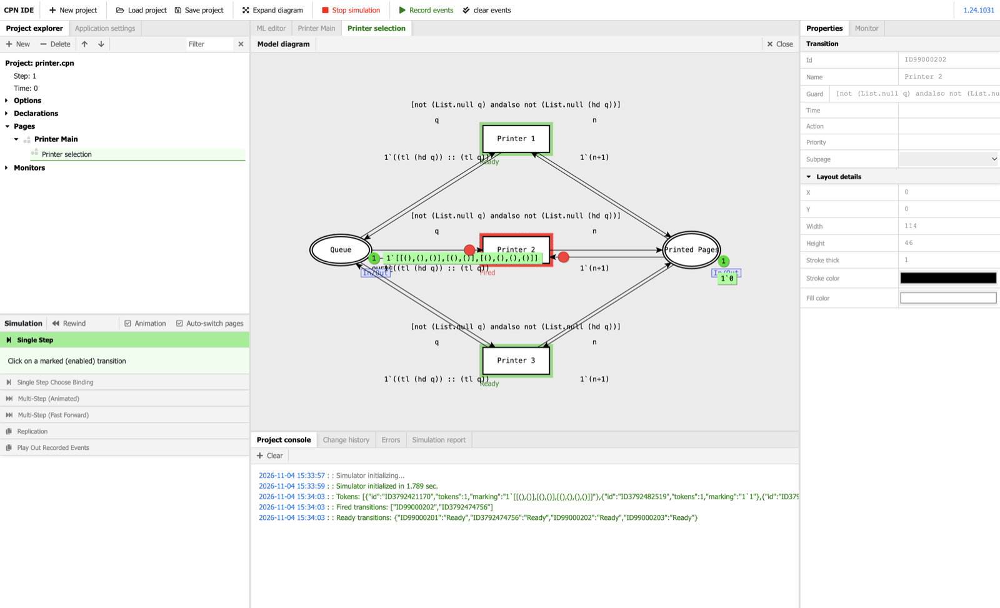

# CPN IDE for macOS (Apple Silicon)

A standalone Mac app for the official **CPN IDE 1.24** (Coloured Petri Nets): editor, declarations, syntax check,
simulation, monitors and replications. It has the same feature set as CPN IDE and the
[cpn-ide-vscode](https://github.com/AleFire99/cpn-ide-vscode) extension, but runs as a normal macOS app with its
own windows, menus and `.cpn` file association.



| Substitution transitions and subpages | Simulation with animated tokens |
|---|---|
|  |  |

## Download

1. Download `CPN-IDE-mac-arm64.zip` from the [latest release](../../releases/latest) and unzip it.
2. Move `CPN IDE.app` to `/Applications`.
3. The app is not notarized by Apple, so macOS blocks it on the first start. Either run

   ```bash
   xattr -dr com.apple.quarantine "/Applications/CPN IDE.app"
   ```

   or try to open it once and then choose **System Settings → Privacy & Security → Open Anyway**.

### Requirements

- A Mac with Apple silicon (M1 or later), macOS 13 Ventura or later
- [Docker Desktop](https://www.docker.com/products/docker-desktop/) or [OrbStack](https://orbstack.dev/).
  The app starts it automatically when needed.
- About 400 MB download for the backend image on the first start, and 0.5–1 GB RAM per open window

## How it works

| Part | Source | Runs |
|---|---|---|
| User interface (Angular) | official CPN IDE installer, `ui/` | natively in Electron (arm64) |
| Backend + CPN simulator | image `ghcr.io/alefire99/cpn-ide-backend` | in Docker (amd64, emulated) |

The CPN simulator is a 32-bit Linux program, so on a Mac it only runs in Docker. The app starts the container
automatically when a window opens (bound to 127.0.0.1 only) and removes it when the window closes. The container
uses tmpfs for `/data` and `/tmp`: the emulated 32-bit simulator cannot read directories on ext4 and otherwise
fails with "Exception raised while setting paths: SysErr".

## Multiple windows

Every window is its own CPN IDE instance with its own backend container (`cpn-ide-mac-backend`,
`cpn-ide-mac-backend-2`, …) and its own storage, so two models can be edited and simulated side by side.

- New window: **File → New Window** (⇧⌘N), or right-click the Dock icon
- Open a file in a new window: **File → Open in New Window** (⇧⌘O)
- Double-clicking a `.cpn` file opens it in a new window, unless there is a window with no model loaded yet

## Changes to the original UI

`scripts/patch-ui.js` applies two fixes to the official UI bundle (it runs automatically after `npm run fetch-ui`):

- **Smooth token animation:** the red tokens move along the actual arc path, also across bendpoints and while
  zooming or panning, at the display's frame rate with ease-in/ease-out. Single-step mode uses 450 ms per phase
  (input arcs, then output arcs) without the original 300 ms pauses. The animation always finishes on time, even
  in a hidden window, so the simulation never waits for it.
- **Instant page switching:** clicking a page in the project tree no longer waits a fixed 1 second before the
  page opens.

## Building from source

Needs Node.js and [Homebrew](https://brew.sh/).

```bash
brew install innoextract
```

```bash
npm install
```

```bash
npm run fetch-ui   # downloads the official installer, unpacks the UI to ui/ and patches it
```

```bash
npm run package    # -> dist/CPN IDE-darwin-arm64/CPN IDE.app
```

For development run `npm start`, optionally followed by the path of a `.cpn` file. To test next to an installed
copy without touching its backends, give the instance its own containers and data folder:
`CPN_IDE_DEV_TAG=test npm start`.

## Files

- `src/main.js`: windows, menus, Docker backend, opening and saving (in the encoding of the XML header, usually ISO-8859-1)
- `src/preload.js`: emulates the old Electron API the UI expects (`remote.dialog`, `fs`, IPC menu commands)
- `src/splash.html`: start screen while the backend boots
- `scripts/fetch-ui.sh`, `scripts/patch-ui.js`, `scripts/package.sh`: download, patch and package

## License

AGPL-3.0. CPN IDE and the backend are licensed under AGPL-3.0 as well.
